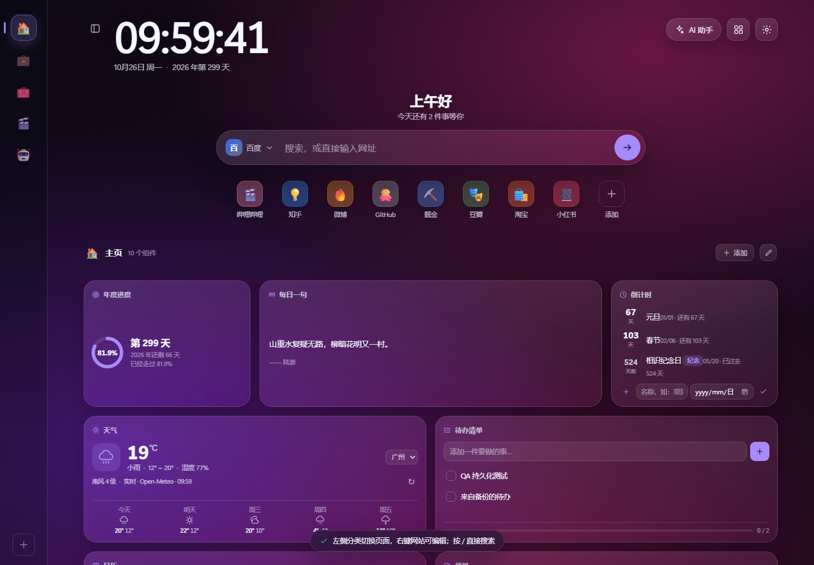
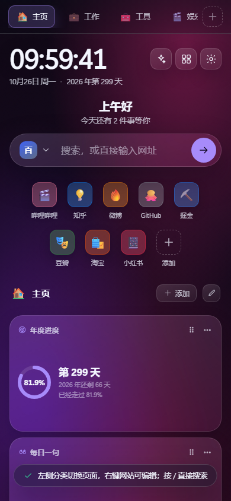

# Lumen Tab · 流光新标签页

一个对标 [WeTab](https://www.wetab.link/) 的新标签页产品：**分类侧边栏、网站图标、文件夹、10 个小组件、搜索与 Dock、可切换本地规则 / API 模型的 AI 助手**。
本地优先、离线可用，数据只落在本机；联网入口只有两个：实时天气（Open-Meteo，可在设置中切回演示）与主动开启的 AI API 模式。支持直接导入 WeTab 导出的 `.data` 备份，把分类、网站和 Dock 迁移过来。同一套代码，既能双击打开，也能作为 Chrome / Edge 扩展接管新标签页。

> GitHub 仓库：<https://github.com/mrtransition/lumen-tab> · 当前版本 **1.6.0**

<p align="center">
  <br>
  
</p>

完整的操作说明见 [使用指南](GUIDE.md)。

## 获取代码

```bash
git clone https://github.com/mrtransition/lumen-tab.git
cd lumen-tab
```

项目没有构建步骤，也不依赖 npm 包；克隆后直接打开 `product/index.html` 或加载 `product/` 为扩展即可。

## 快速开始

| 方式 | 操作 |
| --- | --- |
| 网页版 | 双击 `product/index.html`（推荐 Edge / Chrome） |
| 扩展（推荐） | 打开 `edge://extensions` 或 `chrome://extensions` → 开启「开发者模式」→「加载解压缩的扩展」→ 选择 `product/` 目录 → 新开标签页 |
| 本地服务 | 任意静态服务器指向 `product/`，例如 `npx serve product` |

首次打开会提示：左侧分类切换页面、右键网站可编辑、按 `/` 直接搜索。

## 接入真实模型

1. 打开「设置 → AI」。
2. 选择「API 模型」，点一个常用服务快捷填充，或手填接口地址与模型。
3. 填入 API Key（Ollama 等本地服务可留空）。
4. 点「测试连接」，成功后再点「保存配置」。
5. 打开 AI 助手发消息，就会用该模型回复；右上角徽标会显示模型名。

接口需兼容 `POST /chat/completions`，请求头使用 `Authorization: Bearer <key>`。页面直连可能受 CORS 限制，扩展模式已声明 `host_permissions`。

## 与 WeTab 的功能对照

WeTab 的「图标页 + 侧边分类」是核心：侧栏是分类，点分类后右侧网格换成该分类的网站 / 文件夹 / 组件。本项目按同样交互实现，并对部分联网能力提供离线替代。

| WeTab 能力 | Lumen Tab | 说明 |
| --- | --- | --- |
| 左侧分类栏，点击切换整页图标 | ✅ 已实现 | 分类顺序拖拽、右键重命名 / 换图标 / 删除、折叠展开并记忆 |
| 分类内网站图标（自定义名称 / 图标 / 颜色） | ✅ 已实现 | emoji 图标 + 色块；添加、编辑、打开、删除、拖拽排序 |
| 文件夹图标（2×2 预览、点开查看） | ✅ 已实现 | 新建 / 重命名 / 删除文件夹，文件夹内增删改网站，跨文件夹拖入 |
| 图标跨分类拖动 | ✅ 已实现 | 拖到左侧分类即移动；也可在卡片菜单里选「移动到分类」 |
| 组件与图标混排网格 | ✅ 已实现 | 4/3/2/3 列响应式；组件支持小/中/大尺寸、前后移动、隐藏、加回 |
| 搜索框 / 常用网站 Dock | ✅ 已实现 | 5 个搜索引擎、网址直跳、历史联想；搜索与直跳固定在新标签页打开，保留当前页；Dock 独立快捷栏 |
| 从 WeTab 备份迁移 | ✅ 支持 | 设置 → 数据 → 导入备份，可直接选择 WeTab 导出的 `.data`；导入分类、网站、Dock、主题跟随系统、侧栏折叠、打开方式与最近天气城市 |
| 壁纸与主题 | ✅ 已实现 | 8 套渐变 + 本地上传 + 模糊 / 暗度 / 每日轮换；深浅色 + 5 主题色 |
| 日历 / 天气 / 纪念日 / 热榜等小组件 | ✅ 已实现 | 共 10 个组件；天气默认实时（可切演示），热榜 / 名句按日期种子生成，同一天刷新一致 |
| 右键菜单、拖拽整理 | ✅ 已实现 | 分类、网站、文件夹、组件都有右键菜单 |
| WeTab AI（云端） | 🔁 本地规则 + 可选 API 模型 | 本地模式可读待办 / 习惯 / 倒计时 / 天气并写入待办、启动番茄钟；配置 OpenAI 兼容接口后可调用真实模型 |
| AI PPT / AI 写作 / 思维导图 / 图片编辑 / PPT 模板 / PDF 工具箱 / 小红书模板 | ❌ 未包含 | 依赖 WeTab 云端与素材库，离线单页无法等价实现 |
| 账号登录、多端同步、Pro 订阅 | ❌ 未包含 | 本项目无账号、无服务器；数据以 JSON 备份导入导出 |
| 移动端 App / 浏览器账号级同步 | ❌ 未包含 | 仅提供桌面新标签页（页面本身适配窄屏） |

## 功能

**分类侧边栏**
- 默认 5 个分类：主页（组件）、工作、娱乐、工具、AI；点侧栏切换，右侧显示该分类内容
- 新建 / 重命名 / 换 emoji / 删除分类；拖拽调整顺序；至少保留一个分类
- 顶部按钮折叠侧栏，状态写入本地；窄屏自动变成横向分类条
- 每个分类可混合放网站、文件夹、组件；页头显示当前分类与数量

**网站与文件夹**
- 添加网站：名称 + 网址 + emoji + 颜色；网址自动补 `https://`，只接受 http(s)
- 点击打开；右键编辑 / 复制链接（离线可用）/ 上移下移 / 移动到其它分类 / 删除
- 文件夹 2×2 预览，弹窗内打开、增删改网站，可拖网站进文件夹（上限 40 个）
- 拖拽排序，拖到左侧分类即可跨分类移动；拖入已满文件夹会保留原网站并提示

**交互与可访问性**
- 弹窗 / 文件夹 / 组件库 / 设置面板内 Tab 焦点循环，关闭后焦点回到触发按钮
- 右键菜单支持键盘 ↑/↓/Home/End，Esc 关闭并回焦；贴近视口边缘自动翻转
- 桌面侧栏悬浮或键盘聚焦显示分类名（独立浮层，不被滚动容器裁剪）；窄屏分类名常显
- 点击遮罩关闭普通弹窗 / 文件夹 / 组件库；分类与网站表单例外：Esc、点遮罩和快捷键都不会关闭，只能用「取消 / 创建 / 添加 / 保存」按钮
- Esc 按「菜单 → 弹窗 → 文件夹 → 面板」层级关闭；分类 / 网站表单打开时会拦截 Esc，避免误丢输入
- 新建分类后自动切换并滚动到可见位置；`/` 与 `?` 在浮层打开时不会越过当前浮层
- 搜索引擎下拉使用实体背景并压在 Dock 之上，不会点穿到下方图标；设置里的默认引擎与搜索栏双向同步
- 设置中的原生下拉列表（默认搜索引擎）跟随深/浅色主题，暗色界面不再弹出纯白菜单
- 网站、Dock 与导入数据只接受 http(s)；设置、壁纸、颜色、emoji 均做白名单/长度校验
- 导入备份前二次确认；便签切换/收起前立即落盘；上传壁纸自动压缩，避免撑爆 localStorage

**10 个小组件**（可拖拽排序、切换小/中/大尺寸、隐藏、随时从组件库加回）
1. 年度进度 —— 圆环 + 今年还剩多少天
2. 天气 —— 当前温度、湿度、风力与五日预报，可切城市；默认 Open-Meteo 实时，也可切到离线演示
3. 每日一句 —— 古文名句，可上下切换与收藏
4. 待办清单 —— 添加 / 勾选 / 删除 / 清理已完成，带完成进度
5. 日历 —— 月历翻页、回到今天、标注倒计时日期
6. 便签 —— 多张便签、自动保存、标题与正文
7. 倒计时 —— 纪念日与目标日期，按临近排序
8. 习惯打卡 —— 最近 7 天打卡格 + 连续天数
9. 热榜 —— 微博 / 知乎 / 百度 模拟热榜，点击直接搜索
10. 番茄钟 —— 25/5 专注计时，环形进度，刷新后继续计时

**搜索与 Dock**
- 必应 / 百度 / Google / 知乎 / B 站 五引擎切换，输入网址直跳
- 搜索和网址直跳都在新标签页打开，当前新标签页保持不变
- 历史联想、键盘上下选择；`/` 随时聚焦
- Dock 常用网站：emoji 色块、增删改、拖拽排序、右键菜单

**个性化**
- 深色 / 浅色 / 跟随系统，5 种主题色
- 8 套内置渐变壁纸 + 上传本地图片（也可直接拖图到页面）+ 模糊 / 暗度调节 + 每日轮换

**AI 助手（本地规则 / API 模型两种模式）**
- 默认本地规则：可读取真实本地数据回答待办、习惯、倒计时、天气、年度进度
- 本地模式可执行动作：「帮我安排今天」写入 3 条待办、「开始番茄钟」直接启动计时
- 设置 →「AI」可切换到 API 模型，填写接口地址、模型、Key、温度和最大输出；AI 配置页顶部有完整步骤说明
- 可选「助手设定」：作为系统提示词追加给 API 模型，自定义角色、语气、回答格式与限制，最长 2000 字
- 兼容 OpenAI Chat Completions 协议；内置 OpenAI / DeepSeek / 通义千问 / 智谱 / Ollama 快捷填充
- 面板右上角 `+` 可开始新会话：确认后清空当前对话并回到欢迎语，不加载旧记录；未完成的 API 回复会被中止并丢弃
- 支持「测试连接」、SSE 流式输出、停止生成、错误提示；对话记录仍只存本机
- 兼容 `reasoning_content` / 内联 `think` 标签：思考过程单独收进可展开的「思考过程」块，不混在正式回答里
- AI 回答支持 Markdown：标题、粗体/斜体/删除线、链接、行内代码、代码块（可复制）、列表、引用、分隔线、表格；流式输出时实时渲染
- API 请求会携带当前待办摘要、习惯、倒计时与当前天气（实时缓存或演示），便于模型结合本机上下文回答
- API Key 只存本机 localStorage，不写入导出备份；本地规则 AI 模式不会发起网络请求（天气小组件按「天气数据源」单独请求）

**数据与迁移**
- 全部状态存于 `localStorage` 键 `lumenTab.v1`（当前数据结构 `version: 2`）；天气缓存单独存于 `lumenTab.weather.v1`，10 分钟有效
- 旧版（单一布局 `layout`）备份导入时自动迁移成「主页」分类，不丢组件
- 设置 → 数据：导出 JSON 备份、导入恢复、恢复默认、清空搜索历史
- 存储不可用时自动降级为内存态并提示

**从 WeTab 导入**：WeTab 导出的 `.data` 实际是 JSON。选择后会先识别并显示确认摘要，再覆盖当前数据：

- 导入：分类、网站名称 / 链接、Dock 中能在备份里找到的网站、`followSystem`（映射为跟随系统主题）、侧栏折叠状态、新标签页打开方式、最近天气城市（按经纬度就近映射到内置 8 个城市）。
- 不导入：WeTab 组件（AI、PPT、计算器等）、远程壁纸、远程图片图标、搜索引擎选择 / 自定义引擎、账号 / 云数据。图片图标会转成名称首字 / 文字色块，避免联网抓取。
- 只接受 `http(s)` 链接；本地文件路径等会被跳过。仅含组件的分类会保留为空分类。
- 导入不会下载 WeTab 的远程图片，也不会请求第三方；确认框会列出分类、网站、Dock、跳过组件与图片图标数量。

**快捷键**：`/` 搜索 · `Ctrl/⌘ + K` AI 助手 · `?` 快捷键说明 · `Esc` 关闭浮层 / 文件夹

## 目录结构

```
lumen-tab/
├─ README.md              项目说明与功能对照
├─ GUIDE.md               完整使用指南
├─ NOTES.md               开发笔记、数据字典与验证记录
├─ docs/                  README 预览图
├─ product/               网页本体，同时是扩展根目录
│  ├─ index.html
│  ├─ manifest.json       MV3 扩展清单（chrome_url_overrides.newtab）
│  ├─ assets/             扩展图标 16/32/48/128/256
│  ├─ css/
│  │  ├─ base.css         布局、时钟、搜索、Dock、响应式
│  │  ├─ widgets.css      组件网格与卡片
│  │  ├─ pages.css        分类侧栏、网站 / 文件夹磁贴、分类页响应式
│  │  └─ panels.css       设置 / 组件库 / AI / 弹窗 / Toast
│  └─ js/
│     ├─ icons.js         内联 SVG 图标
│     ├─ util.js          日期、种子随机、URL、文件工具
│     ├─ data.js          引擎、壁纸、城市（含经纬度）、名句、热榜、默认分类与网站
│     ├─ weather.js       Open-Meteo 客户端、WMO 映射、缓存与离线回退
│     ├─ webtab-import.js WeTab `.data` 识别、分类 / 网站 / Dock 映射与安全清洗
│     ├─ store.js         状态 + 持久化 + 分类/网站/文件夹动作 + 导入迁移
│     ├─ widgets-core.js  年度进度 / 天气 / 名句 / 日历 / 热榜
│     ├─ widgets-prod.js  待办 / 便签 / 倒计时 / 习惯 / 番茄钟
│     ├─ search.js        搜索 + Dock
│     ├─ ui.js            面板、设置、分类管理、弹窗、菜单、Toast
│     ├─ pages.js         侧栏 + 分类页网格 + 文件夹 + 拖拽
│     ├─ ai.js            本地 AI 规则引擎 + 对话面板
│     ├─ ai-api.js        OpenAI 兼容 API 客户端（SSE / 错误处理，仅 API 模式调用）
│     ├─ markdown.js      轻量 Markdown 渲染（先转义再生成白名单标签）
│     └─ app.js           启动、主题壁纸、时钟、全局快捷键
├─ tests/unit.test.mjs    纯逻辑断言（node:test）
└─ qa/qa.mjs              统一 CDP QA（smoke / targeted / full / extension / shots）
```

## 开发与验证

环境：Node.js **22+**（CDP 客户端使用内置 WebSocket）、本机 Edge 或 Chrome。无需 `npm install`。

```bash
node --test tests/unit.test.mjs                         # 纯逻辑断言
node qa/qa.mjs --mode smoke                             # 启动 / 首屏
node qa/qa.mjs --mode targeted                          # 交互回归
node qa/qa.mjs --mode full --widths 390,768,1440        # 全量 + 响应式
node qa/qa.mjs --mode extension                         # 以扩展方式加载并验证新标签页
node qa/qa.mjs --mode full --shots                      # 额外生成 docs/preview-*.png
```

QA 默认使用无头 Edge / Chrome；不在默认安装路径时可通过环境变量指定：

```bash
# Windows PowerShell
$env:EDGE_PATH = 'D:\Apps\msedge.exe'

# macOS / Linux
EDGE_PATH=/path/to/chrome node qa/qa.mjs --mode smoke
```

天气请求默认被 QA 注入固定响应，避免依赖第三方网络；需要验证真实 Open-Meteo 连通性时：

```bash
QA_REAL_WEATHER=1 node qa/qa.mjs --mode smoke
```

最近一次验证（2026-10-27）：单元测试 34/34、CDP 交互 161/161、CDP 全量 197/197（分类切换、网站/文件夹增删改、跨分类拖拽、分类管理、折叠、Lumen / WeTab 导入与二次确认、WeTab 主题 / 侧栏 / 空分类 / Dock 映射、分类 / 网站表单只能点按钮关闭、持久化、浮层焦点循环与回焦、菜单键盘与边界、搜索引擎下拉层级与背景、搜索/网址直跳在新标签页打开且保留当前页、设置原生下拉暗色列表、实时天气（Open-Meteo 固定响应）、天气演示/实时切换与缓存、AI 配置说明/配置保存/本机 Key 持久化/测试连接/助手设定注入系统提示词/SSE 流式回复/思考内容折叠/Markdown 渲染/密钥不导出、AI 新会话清空并拒绝迟到回复、危险协议拒绝、390/768/1440 响应式与内容裁切）、扩展模式 4/4；另有真实天气联网 smoke 16/16。实际 WeTab 备份转换校验：12 个分类、124 个网站、1 个 Dock，跳过 30 个组件与远程壁纸。

## 数据说明与边界

- **天气默认联网**：小组件请求 Open-Meteo（无需 Key，只发送所选城市经纬度），成功后缓存 10 分钟；断网或请求失败时回退到内置演示数据。设置 → 外观 →「天气数据源」可切到「演示（离线）」，切换后不再发起天气请求。热榜、名句仍为内置演示数据。
- **AI 默认是本地规则引擎**，不发起网络请求；只有主动在设置 → AI 切换到 API 模式后，发送消息才会请求你填写的 OpenAI 兼容接口。
- **AI 新会话会清除当前对话**并只保留欢迎语，不会加载旧记录；确认前请先复制需要保留的内容。
- API Key 以明文保存在本机 `localStorage`，导出的 JSON 备份会剔除 Key；请只在可信设备上保存私人 Key。
- 直接双击 HTML 时，浏览器直连 API 可能受服务端 CORS 限制；扩展模式已申请 `http(s)` host 权限。请求失败时优先检查接口地址、模型、Key 与 CORS。
- API 模式只能对话，不会直接写入待办或启动番茄钟；需要执行本机动作时切回「本地规则」。
- **网站图标使用 emoji / 首字**，不抓取 favicon，默认离线；WeTab 导入的图片图标也按此规则转成文字色块。
- **WeTab 导入只在本地解析**：不下载 `bgImage` / 远程壁纸，不请求第三方；只迁移分类、网站、Dock 和少量设置。WeTab 组件、自定义搜索引擎、账号 / 云数据不会迁移，仅含组件的分类会保留为空。
- 自定义壁纸上传时会缩放到 1920px 并压缩为 JPEG 再存入 localStorage（小 GIF 保留原图），避免超出存储配额。
- 扩展未上架商店，需开发者模式加载；Safari / 移动端浏览器不提供新标签页覆盖能力。
- 触屏上的网站/文件夹编辑依赖长按触发右键菜单：Chrome / Edge Android 支持，iOS Safari 不派发 `contextmenu`，建议在桌面完成整理。
- 如需接其它天气服务：替换 `js/weather.js` 的 `endpointFor` 与 `parsePayload`，保持 `{ current, days }` 结构即可；城市坐标在 `js/data.js` 的 `CITIES`。热榜 / 名句仍可通过替换 `js/data.js` 的 `HOT_SOURCES / QUOTES` 接入。

## 反馈

问题、建议或兼容性反馈请提交到 [GitHub Issues](https://github.com/mrtransition/lumen-tab/issues)。

